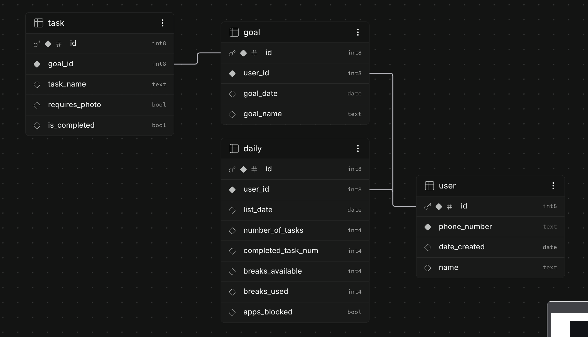

# First Things

First Things is a PWA for the IS-401 Project Management course. Plan goals, finish daily tasks, and earn simulated breaks with George.

## Get it working on your phone

**Live app: [Open First Things](https://aarongarry.github.io/first-things-PWA/)**

First Things is a **Progressive Web App (PWA)**: a website you can add to your Home Screen. It opens in its own app window and caches the files it needs for offline use. You do **not** need to download the repository, run a local server, or install anything from the App Store to use the published app.

### iPhone — start here

1. Open **[the live app](https://aarongarry.github.io/first-things-PWA/)** in **Safari** on your iPhone. If you opened the link inside another app, open it in Safari first.
2. Tap **Install First Things** on the welcome page for instructions. Already signed in? Find the same option under **Settings**.
3. In Safari, tap **Share** (the square with an upward arrow). Depending on Safari’s layout, it may be inside the page menu.
4. Scroll through the share options and tap **Add to Home Screen**. If it is missing, check **Edit Actions** at the bottom of the share sheet.
5. Keep **Open as Web App** enabled if shown, then tap **Add**.
6. Open the **First Things** icon from your Home Screen while you still have internet. Enter your phone number. Use the same number you used on the website to load the same account; new users can enter a name and complete the setup.
7. Wait for **All changes synced**. Keep the app open briefly so its files can finish caching, then use the offline check below. The install guide in the browser also reports when that browser is ready for offline use.

The install button displays instructions on iPhone; Safari requires you to finish **Add to Home Screen** yourself. Installing does not send a text message or require a verification code.

### Android

1. Open [the live app](https://aarongarry.github.io/first-things-PWA/) in **Chrome**.
2. Tap **Install First Things** and accept the browser’s install prompt.
3. If no prompt appears, use Chrome’s **⋮ → Install app** or **Add to Home screen**.
4. Open the installed app while online, sign in with the same phone number, and wait for **All changes synced**.

### Check that offline mode works

1. Add a task online and wait for **All changes synced**.
2. Enable airplane mode. Add another task and complete a task.
3. Close and reopen the Home Screen app. The tasks and completion state should still be there.
4. Turn airplane mode off and leave First Things open until it shows **All changes synced**.
5. Sign in on another device with the same number to confirm that the changes arrived.

### If something does not work

| Problem | What to do |
| --- | --- |
| No automatic install pop-up on iPhone | This is expected. Use Safari’s **Share → Add to Home Screen**. |
| App opens to an empty or different account | Check the number. Use the same number on every device, and connect to the internet the first time on a new device. |
| Edits have not reached another phone | Reconnect and leave the app with the edits open until **All changes synced** appears. Then reopen/focus the other device’s app. |
| Old interface after an update | Reopen the app online and tap **New version ready** when offered. Changes are saved before the app reloads. |
| Offline launch fails | Open the Home Screen app online first so its files can be cached. Do not clear website data while you have unsynced edits. |
| A local development link does not work on the phone | `localhost` on your phone refers to the phone itself. Use the public HTTPS link above; a plain HTTP LAN address does not enable service workers. |

## Edit your profile

1. Open **Settings** using the bottom navigation or your initial at the top of Today.
2. Tap **Edit** next to your name and number.
3. Change your name, phone number, or both, then tap **Save profile**.

Name changes save on this device immediately and can sync later if you are offline. A phone-number change requires internet so the app can sync pending tasks, check that the new number is unused, and move the account together with its goals, tasks, preferences, and progress.

After changing numbers, use the **new number** to sign in on every device. An account already using that number will not be overwritten or merged. The old number stops being a sign-in for this account (you can move back to a number previously held by the same account); devices still signed in with it are asked to sign out, and cannot recreate the old cloud account. Unsynced edits from another device remain in that device’s old local account, so sync your other devices before changing numbers.

If the connection drops during a number change, the app keeps a recovery record and retries while open after reconnecting. Wait for confirmation before switching numbers again. No verification code is sent; these remain demo accounts.

## Instagram reminder with Apple Shortcuts (iPhone)

This optional integration redirects you away from Instagram when your **synced** list has unfinished tasks and no active earned break. It is a voluntary reminder, not a Screen Time lock. The PWA cannot install an automation for you. The phone setup still needs to be completed in Apple Shortcuts.

### Connect your account

1. Update First Things, sign in, and wait for **All changes synced**.
2. In **Settings → Restricted apps**, select **Instagram**.
3. Open **Settings → Instagram shortcut**. Tap **Test my Instagram check** to verify the server response. The setup has three expandable sections, including copy buttons for your Check URL, API key, and Reminder URL.
4. Keep your Check URL private. Its random account link can read only the Instagram access decision/message; it contains no phone number and follows your account if you change numbers. The API key is the existing browser-safe publishable key, not a service-role key. Demo phone sign-in remains unverified; this is not production authentication.

### Create “Check First Things” in Apple Shortcuts

Create a shortcut with these actions **in this order**:

1. **URL** — paste your **Check URL** from the setup screen.
2. **Get Contents of URL** — use that URL, method **GET**. Expand options and add a header: name **apikey**, value your copied **API key**.
3. **Get Dictionary Value** — get the value for **decision** in **Contents of URL**.
4. **If** — **Dictionary Value is allow**. In this branch add **Nothing**.
5. Inside **Otherwise**, add **URL** with your **Reminder URL**, then **Open URLs** using that URL. Keep both actions before **End If**.

Name the shortcut **Check First Things**. Run it once and approve connecting to this project's Supabase domain/opening the reminder if asked. If Shortcuts asks for a type for the condition, use Text. Do not add an action to open Instagram: it is already open when the automation fires, and reopening it can cause a loop.

### Attach it to Instagram

Create an automation with the **App** trigger → **Instagram** → **Is Opened** → **Run Immediately**. Choose **Check First Things**, or add **Run Shortcut** and select it. Save. Depending on the iOS Shortcuts layout, automation creation may be in the Automation section or presented as a trigger attached to a shortcut; the trigger and action sequence above are the same. This has not yet been verified on the user's iOS 27.2 phone.

### Test on your phone

- **Paused:** Add an unfinished task, wait for **All changes synced**, then open Instagram. It should redirect to the First Things reminder.
- **Allowed:** Complete all tasks and sync. Switch away from Instagram and reopen it; the shortcut should leave it open.
- **Earned break:** With unfinished tasks and an earned break, start the break in First Things and sync. Instagram should stay open. After the break expires, switch away and reopen Instagram to check again.
- **Next day:** Open First Things each morning to refresh and sync the day's list. Until then, the check returns `refresh`, which uses the same reminder.
- **Offline:** A failed network request can stop the shortcut and leave Instagram open. Offline task editing still works, but this integration needs internet and does not enforce an offline block.

The redirect may open **Safari**, which can have a different login session from your installed PWA. Open the Home Screen app to use your existing session. The automation can be disabled, the app may flash before redirecting, and break expiry does not evict you from an already-open app. If you travel to a different time zone, reopen setup and replace the Check URL. Simulated time travel in Demo controls returns `refresh`; reset to real time before testing the shortcut.

Apple references: [App triggers](https://support.apple.com/en-om/guide/shortcuts/apde31e9638b/ios), [API requests](https://support.apple.com/en-mt/guide/shortcuts/apd58d46713f/ios), [Dictionary values](https://support.apple.com/en-ie/guide/shortcuts/apdf01294032/ios).

## Phone accounts and offline use

- Enter a phone number to create or open a **demo account**. No SMS or verification code is used. A name is optional; returning accounts keep their saved name.
- US/Canadian 10-digit numbers normalize to `+1`. For other countries include the country code. Punctuation and spaces do not create separate accounts.
- **Anyone who knows the number can open and edit that demo account.** Use sample numbers and non-sensitive tasks. This is deliberately not production authentication.
- Tasks, goals, preferences, onboarding, and progress save immediately to this device. You can add, edit, delete, and complete tasks offline, including after closing and reopening the installed app.
- Changes sync when connectivity returns **while the app is open**, and when you reopen/focus it. iOS does not guarantee background sync after the app is closed. Other devices refresh on focus or every 30 seconds while visible.
- First use on a new device needs internet to load an existing cloud account. An uncached number used offline can start locally and merge when connected.
- Signing out keeps local accounts and pending edits. Clearing website data/removing app storage can erase changes that have not synced.
- Independent task additions and field edits merge. For the same field, the device syncing its pending edit last wins. Deleting an item wins over a stale edit to it. Server revisions prevent a stale full snapshot from silently overwriting newer data.
- The top status shows **All changes synced**, **Offline**, or a retryable problem. A local-storage failure is shown separately; keep the app open if that occurs.
- App updates download a complete new shell and offer **New version ready**. Tapping it saves local changes before reloading. Account data is separate from the app cache.

## What is real and what is simulated

**Real:** Home Screen installation, phone-number account lookup, persistent goals/tasks, offline editing, reconnect sync, and responsive mobile layout.

**Optional integration:** an Apple Shortcuts Instagram reminder uses real synced task/break status, after manual setup on each iPhone.

**Simulated:** the in-app blocking preview, George AI, calendar connection, photo verification, and lock-screen notifications. A PWA cannot enforce a native iPhone app lock.

## Development

The frontend is plain HTML/CSS/JavaScript in `docs/`, with no build step or runtime package dependencies.

```sh
npm start
# http://localhost:4173
npm test
```

You can also run `python3 -m http.server 4173 --directory docs`. The macOS `Start First Things.command` uses this same folder. Service workers work on localhost or HTTPS; opening an HTML file directly does not enable offline use. A plain HTTP LAN URL on a phone is not sufficient for service-worker testing.

When editing locally, an installed service worker may keep serving the previous release. Close all app tabs or accept the update banner. **Bump the cache version in `docs/sw.js` whenever any cached frontend file changes**, then reload to install and accept the new version.

## Supabase setup

The project URL and browser-safe publishable key are in `docs/supabase-config.js`. Keep service-role/secret keys out of frontend code.

Run **`supabase/pwa-demo-accounts.sql`** when setting up the project or upgrading to profile editing in the project's SQL Editor. It is repeatable and creates a separate `first_things_demo_accounts` snapshot table and load/save/rename RPC functions. Re-running it adds the profile-editing columns and function without deleting existing accounts. Table access is blocked; the intentionally unverified demo API looks up one supplied phone number. Writes use a revision check and transaction lock. No anonymous-auth setting or external SDK is required for the new PWA.

For the Instagram integration, also run **`supabase/instagram-shortcut.sql`** after the demo-account migration. This repeatable script creates account-linked status keys and two narrow RPCs. `first_things_instagram_status` supports GET with the publishable `apikey` header, uses server time and the configured time zone, and returns only `decision` (`allow`, `pause`, or `refresh`) and `message` with `Cache-Control: no-store`. It never changes task data. `tests/instagram-status.sql` runs database behavior checks in a rolled-back transaction.

`supabase/setup.sql` and the original user/goal/task/daily ERD remain available for the earlier authenticated vertical slice. The migration does not alter or expose those records. When an old browser login and its still-valid anonymous session are present, the app imports those tasks into that remembered phone account once. An expired old session or a different browser may require a manual team-assisted transfer; old records remain in the original tables.

Set `USE_SUPABASE` to `false` for device-only persistence without cloud syncing.

## Publish

GitHub repository **Settings → Pages → Deploy from a branch → main → /docs**. HTTPS is required. This repository is configured to publish that folder automatically when `main` changes. Relative manifest URLs and the service-worker scope support the `/first-things-PWA/` subpath.

## Verification

`npm test` covers task behavior, legacy session/sync behavior, phone normalization, durable offline edits, reconnect, account isolation, two-device merge/deletion conflicts, concurrent saves, storage failure, service-worker caching at a repository subpath, profile edits, number collisions, and recovery after a phone-change response is lost.

For a device smoke test:

1. Install in Safari, enter a sample number, finish setup, and add a task. Wait for **All changes synced**.
2. Turn on airplane mode, add another task and complete one. Close and reopen the app; both edits should remain.
3. Reconnect with the app open. Wait for **All changes synced**.
4. Open the website on a second device, use the same number, and verify the tasks and completion state.
5. Sign out and use a different number; its task list should be separate.


